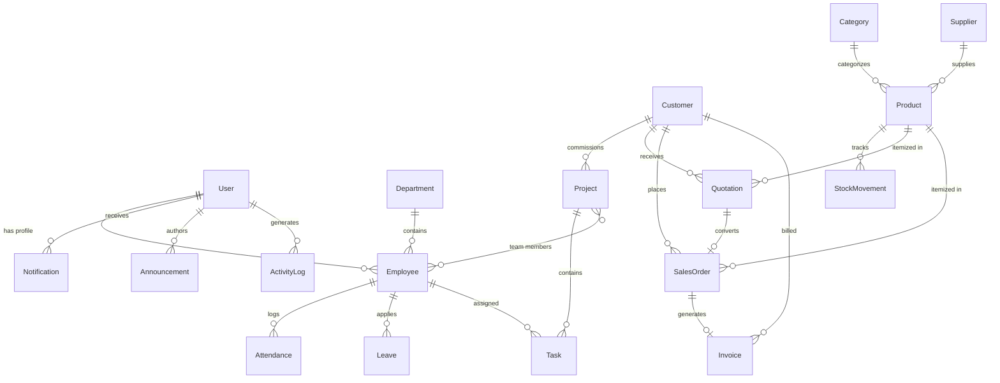

# Entity Relationship (ER) Diagram – ERP Management System

This document illustrates the entity relationships across the Mongoose models in the ERP system using Mermaid.

---

## Mermaid ER Diagram

